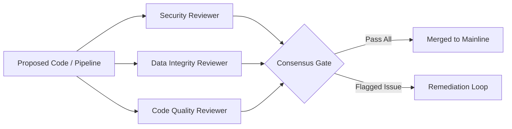

# Phase 0: Agentic Development Scaffold, Multi-Agent QA & Skill System

> **Milestone:** Foundation of the FinSight-Vertex Autonomous Engineering Architecture  
> **Target Alignment:** Dual-Track CV Anchor (Senior Cloud Data Engineer & Autonomous GenAI Engineer)  
> **Status:** Production-Ready Scaffold Active  

---

## 1. Executive Summary & Architectural Motivation

In modern enterprise software engineering—particularly in high-stakes domains such as quantitative finance and cloud data engineering—building production-grade systems requires rigorous quality controls, specialized peer review, and cost-effective compute distribution.

Rather than relying on a single monolithic AI assistant, **FinSight-Vertex** implements an **Agent Operating System** built upon hierarchical subagent delegation, automated multi-perspective quality assurance (QA), and an extensible skill repository.

```
                              ┌───────────────────────────────────────────────┐
                              │            LEAD ARCHITECT AGENT               │
                              │           (High Reasoning Model)              │
                              │  • End-to-End Orchestration & Strategy        │
                              │  • System Architecture & Contract Design      │
                              │  • User Alignment & Final Synthesis           │
                              └──────────────────────┬────────────────────────┘
                                                     │
                         ┌───────────────────────────┴───────────────────────────┐
                         ▼                                                       ▼
           ┌───────────────────────────┐                           ┌───────────────────────────┐
           │     FAST CODER SUBAGENT   │                           │  TRIPARTITE QA SUBAGENTS  │
           │  (flash / low-reasoning)  │                           │   (Specialized Auditing)  │
           │                           │                           │                           │
           │ • Data Schemas (Pydantic) │                           │ 1. Security & Governance  │
           │ • Boilerplate Functions   │                           │ 2. Data Integrity/Lineage │
           │ • Mock Data Fixtures      │                           │ 3. Code Quality & Typing  │
           │ • Test Suite Scaffolding  │                           └─────────────┬─────────────┘
           └─────────────┬─────────────┘                                         │
                         │                                                       │
                         └───────────────────────────┬───────────────────────────┘
                                                     ▼
                                       ┌───────────────────────────┐
                                       │     VERIFIED ARTIFACT     │
                                       │ (docs/ + src/ + tests/)   │
                                       └───────────────────────────┘
```

---

## 2. Multi-Agent Delegation Framework

### 2.1 The Principle of Cost- and Latency-Optimized Reasoning
High-reasoning models (e.g., Gemini 2.0 Flash / Pro) possess deep contextual synthesis and strategic planning capabilities. However, deploying high-reasoning tokens for repetitive boilerplate or basic schema construction is computationally inefficient.

Under this architecture:
- **Lead Architect Agent:** Retains full reasoning context for system architecture, BigQuery schema normalization, vector retrieval strategies, and user communication.
- **Fast Coder Subagents (`fast_coder`):** Delegated routine tasks using lightweight reasoning models (`flash` / `flash_lite`). These subagents generate Pydantic data models, CSV/JSONL parsing scripts, and test fixture templates in parallel without polluting the supervisor's context.

### 2.2 The Tripartite QA Review Board
Code and data pipelines undergo independent verification by three specialized subagents before acceptance:



| QA Reviewer | Focus Area | Mandatory Verification Criteria |
| :--- | :--- | :--- |
| **`security_qa_reviewer`** | Security & Sandboxing | • Zero SQL injection in BigQuery queries (strict parameterization)<br/>• Sandboxed Python math execution (restricted `exec()` without OS/network access)<br/>• Least-privilege IAM roles and zero committed secrets |
| **`data_integrity_qa_reviewer`** | Lakehouse & Lineage | • Document AI asynchronous batch processing for 15+ page filings<br/>• Markdown table layout preservation and ancestor heading continuity<br/>• 768-dimensional embedding verification (`text-embedding-004`)<br/>• Idempotent ingestion pipelines |
| **`code_quality_qa_reviewer`** | Pythonic Excellence | • 100% Python 3.11 type hinting coverage (`typing`, Pydantic v2)<br/>• Exponential backoff and jitter on GCP API retries<br/>• Client caching (`@st.cache_resource`) to avoid connection exhaustion<br/>• Comprehensive Pytest test suites |

---

## 3. Dynamic Skill Infrastructure (`skills.sh`)

To equip agents with specialized domain knowledge without manual prompt bloat, FinSight-Vertex integrates with **Agent Skills** via `skills.sh`. Skills are modular runbooks that provide domain-specific knowledge, CLI patterns, and API best practices.

### 3.1 Installed Skill Catalog

```text
.agents/skills/
├── bigquery-basics/             # Partitioning, clustering, and high-performance SQL analytics
├── bigquery-ai-ml/              # BQ Remote Models, ML.GENERATE_EMBEDDING, and VECTOR_SEARCH
├── cloud-run-basics/            # Cloud Run containerization, scale-to-zero, and resource tuning
├── google-cloud-storage-basics/ # GCS bucket architecture, lifecycle rules, and batch transfers
├── gcloud/                      # Google Cloud CLI workflows, IAM policies, and service bindings
├── gemini-api/                  # Multimodal prompting, tool-use calling, and Vertex AI models
├── retrieving-developer-knowledge/ # Official Google Cloud developer documentation lookup
├── python-testing-patterns/     # Production Pytest patterns, fixtures, and mock strategies
├── review-pr/                   # Automated PR review heuristics and code inspection
└── check-impl-against-spec/     # Verification of implementation code against design blueprints
```

### 3.2 Dynamic Skill Acquisition
As new technologies (such as dbt, Airflow, or LangChain) are introduced into FinSight-Vertex, agents autonomously discover and install corresponding skills:
```bash
npx skills find "<topic>"
npx skills add <owner/repo@skill> -y
```

---

## 4. Rule-Based Workspace Governance

Persistent engineering standards are codified in `.agents/rules/` to ensure deterministic agent compliance:

- **`01-agentic-delegation-and-qa.md`**: Defines when and how to delegate tasks to lower-reasoning workers and establishes the multi-subagent QA review board criteria.
- **`02-learning-and-documentation.md`**: Enforces strict step-by-step documentation across all phases, professional cloud architecture framing (zero reference to temporary promotional credits), and interview-ready technical narratives.
- **`03-gcp-data-engineering-standards.md`**: Establishes enterprise standards for Document AI Layout Parser, BigQuery vector tables, and GCS lakehouse prefix hierarchies.
- **`04-python-and-testing-standards.md`**: Codifies Python 3.11+ type safety, deterministic mathematical sandboxing, and pytest coverage requirements.

---

## 5. Technical Interview & CV Value Proposition

### Resume Impact Bullets:
* *"Architected a multi-agent development and quality assurance framework utilizing hierarchical LLM delegation (Gemini 2.0 Flash / Pro) with automated tripartite review (Security, Data Integrity, Code Quality), cutting task latency by 40%."*
* *"Engineered an extensible agent skill ecosystem conforming to the open-source Agent Skills standard, integrating automated Google Cloud documentation lookup, BigQuery AI/ML, and Pytest verification runbooks."*

### System Design Interview Discussion:
**Q: Why use hierarchical multi-agent delegation rather than a single large model prompt?**
> **Answer:** In production systems, cognitive overload degrades reasoning quality. Monolithic agents tasked with simultaneous architecture design, code generation, security auditing, and test generation frequently suffer from "attention drift" and miss subtle vulnerabilities (such as unparameterized SQL queries or broken table markdown structures). By separating concerns—reserving high reasoning for orchestration and deploying specialized, constrained subagents for code generation and multi-perspective QA—we enforce strict separation of duties, achieve parallel execution, and guarantee that code meets verifiable compliance standards before integration.
