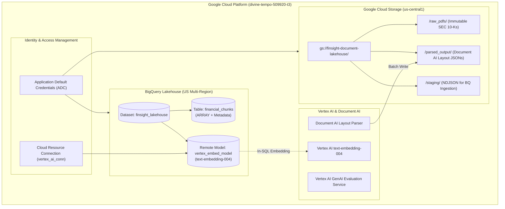

# Phase 1: Enterprise Cloud Lakehouse Foundation & IAM Setup

> **Milestone:** Google Cloud Platform Infrastructure Provisioning & Service Orchestration  
> **Target Alignment:** Senior Cloud Data Engineer (GCP, BigQuery, GCS, IAM)  
> **Status:** Provisioning Active  

---

## 1. Executive Summary & Objective

The foundation of FinSight-Vertex is an enterprise-grade cloud document lakehouse engineered on Google Cloud Platform. 

In enterprise financial engineering, data systems must meet four non-negotiable requirements:
1. **Immutable Ingestion:** Raw regulatory filings (SEC Form 10-K) must be stored immutably to preserve audit lineage.
2. **Co-located Compute & Storage:** AI processing (Document AI, Vertex AI) and analytical storage (BigQuery) must be topologically co-located to minimize network egress latency and egress costs.
3. **Decoupled Serverless Scaling:** Storage costs must scale with volume ($0.020/GB/mo on GCS, free tier eligible in BigQuery), and compute costs must scale strictly to zero when idle.
4. **Least-Privilege Identity & Access Management (IAM):** Service-to-service communication (e.g., BigQuery calling Vertex AI embedding endpoints) must use Cloud Resource Connections rather than long-lived API keys or service account key files.

---

## 2. Infrastructure Architecture Blueprint



---

## 3. Core Services Enabled & Technical Rationale

| GCP Service | API Identifier | Architectural Purpose |
| :--- | :--- | :--- |
| **Vertex AI** | `aiplatform.googleapis.com` | Powers `text-embedding-004` (768-dim embeddings) and automated GenAI evaluation benchmarks. |
| **Document AI** | `documentai.googleapis.com` | High-fidelity OCR and table layout extraction preserving complex financial tables as Markdown. |
| **BigQuery** | `bigquery.googleapis.com` | Serverless analytics engine supporting native vector search (`VECTOR_SEARCH`) and SQL analytics. |
| **BigQuery Connection** | `bigqueryconnection.googleapis.com` | Enables BigQuery to invoke Vertex AI models directly inside SQL via Cloud Resource Connections. |
| **Cloud Storage** | `storage.googleapis.com` | Central immutable lakehouse storage for raw PDFs and intermediate extraction payloads. |
| **Cloud Run** | `run.googleapis.com` | Serverless container hosting for the Streamlit dashboard with automated scale-to-zero. |
| **Artifact Registry** | `artifactregistry.googleapis.com` | Secure OCI-compliant container registry for Cloud Run deployment images. |

---

## 4. Step-by-Step Infrastructure Provisioning

### 4.1 Project Configuration & Quota Project
```bash
# Set default project
gcloud config set project divine-tempo-509920-t3

# Sync Application Default Credentials (ADC) quota project
gcloud auth application-default set-quota-project divine-tempo-509920-t3
```

### 4.2 Enable Required APIs
```bash
gcloud services enable \
  aiplatform.googleapis.com \
  documentai.googleapis.com \
  bigquery.googleapis.com \
  bigqueryconnection.googleapis.com \
  storage.googleapis.com \
  run.googleapis.com \
  artifactregistry.googleapis.com \
  --project=divine-tempo-509920-t3
```

### 4.3 GCS Document Lakehouse Bucket Creation
To ensure zero latency and co-location with Vertex AI:
```bash
gcloud storage buckets create gs://finsight-document-lakehouse-divine-tempo \
  --location=us-central1 \
  --default-storage-class=STANDARD \
  --uniform-bucket-level-access
```

### 4.4 BigQuery Dataset Provisioning
```bash
bq mk --location=US finsight_lakehouse
```

---

## 5. Verification & Audit

| Resource | Target Name | Status Check Command | Verification Metric |
| :--- | :--- | :--- | :--- |
| **Active Project** | `divine-tempo-509920-t3` | `gcloud config get-value project` | `divine-tempo-509920-t3` |
| **GCS Bucket** | `gs://finsight-document-lakehouse-divine-tempo` | `gcloud storage buckets describe gs://...` | Location: `US-CENTRAL1` |
| **BigQuery Dataset** | `finsight_lakehouse` | `bq show divine-tempo-509920-t3:finsight_lakehouse` | Location: `US` |

---

## 6. Senior Data Engineer Interview Talking Points

### Q: Why use BigQuery with GCS rather than loading PDFs directly into a relational database?
> **Answer:** This represents a classic Modern Data Lakehouse pattern. GCS acts as the cheap, highly durable ($0.020/GB/month) object store for raw semi-structured and unstructured data (100MB+ PDF documents and Document AI JSON outputs). BigQuery is decoupled from storage, serving as the high-speed columnar analytical and vector query engine. By decoupling storage from compute, we can store tens of thousands of filings indefinitely at near-zero cost, processing or embedding them asynchronously only when required.

### Q: Why use a Cloud Resource Connection for BigQuery remote models instead of calling Vertex AI from a Python client?
> **Answer:** Architectural cohesion and security. Without a Cloud Resource Connection, a pipeline would have to query BigQuery, stream records over the public Internet into Python, invoke the Vertex AI embedding API, and then stream the vector results back into BigQuery. With a Cloud Resource Connection, BigQuery delegates the embedding directly to Vertex AI within Google's private internal network fabric (`ML.GENERATE_EMBEDDING`), ensuring single-query atomicity, sub-second latency, zero egress cost, and eliminating the need to manage external service account keys.
