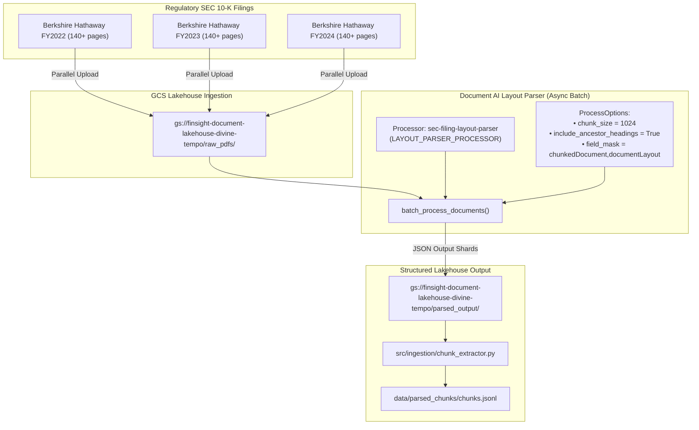

# Phase 2: SEC 10-K Ingestion & Document AI Layout Parser Batch Pipeline

> **Milestone:** Regulatory Filing Ingestion & Table-Preserving Layout Extraction  
> **Target Alignment:** Senior Cloud Data Engineer (Document AI, Asynchronous Batch ETL, Table Preservation)  
> **Status:** Code Implemented & Filings Staged to GCS  

---

## 1. Executive Summary & Objective

In financial AI systems, the fidelity of unstructured document ingestion determines the upper bound of retrieval accuracy. Financial reports—particularly annual SEC Form 10-Ks—are dominated by dense numerical tables, multi-column layouts, footnotes, and deeply nested hierarchical sections (e.g., *Item 7. Management's Discussion and Analysis of Financial Condition and Results of Operations*).

Naive RAG pipelines that rely on heuristic text splitting (such as character count or sentence tokenization) frequently split financial tables mid-row, separating column headers from numerical values. This causes catastrophic failure during question answering and quantitative reasoning.

**Phase 2** establishes an enterprise Document Lakehouse ETL pipeline using Google Cloud **Document AI Layout Parser**, specifically configured to:
1. Ingest multi-year SEC 10-K filings asynchronously.
2. Preserve tables as unified, atomic Markdown blocks.
3. Inject hierarchical ancestor headings (`include_ancestor_headings = True`) into each chunk to retain global contextual meaning.

---

## 2. Ingestion Architecture Blueprint



---

## 3. Engineering Trade-Offs: Layout Parser vs. Naive Splitters

| Evaluation Dimension | LangChain `RecursiveCharacterTextSplitter` | LlamaIndex `SentenceSplitter` | PyPDF / PDFPlumber | **Google Document AI Layout Parser** |
| :--- | :--- | :--- | :--- | :--- |
| **Table Preservation** | ❌ Slices tables across arbitrary character boundaries | ❌ Treats table lines as disconnected sentences | ⚠️ Requires manual heuristic coordinate parsing | **✅ Converts full tables directly to structured Markdown** |
| **Hierarchical Heading Context** | ❌ None (chunks lose section identity) | ❌ None | ❌ None | **✅ Automatically prepends H1/H2 ancestor headings** |
| **Multi-Column Flow** | ❌ Merges adjacent columns into jumbled text | ❌ Reads strictly left-to-right | ⚠️ Prone to column bleed | **✅ Layout-aware bounding box reading flow** |
| **Processing Limits** | Local compute only | Local compute only | Local compute only | **✅ Asynchronous batch API handles 1,000+ page documents** |

---

## 4. Addressing the 15-Page Limit with Asynchronous Batch Processing

> [!IMPORTANT]
> **Production GCP Constraint:** The synchronous Document AI endpoint (`client.process_document()`) enforces a strict hard limit of **15 pages per request**. SEC Form 10-Ks are 80 to 200+ pages. Attempting synchronous extraction on full filings results in an immediate `INVALID_ARGUMENT` gRPC error.
>
> **Enterprise Solution:** We implement asynchronous batch processing (`client.batch_process_documents()`) reading directly from GCS prefixes and writing output JSON shards to GCS.

### Ingestion Implementation (`src/ingestion/docai_parser.py`)

```python
def batch_process_filings(
    processor_id: str,
    project_id: str = settings.PROJECT_ID,
    location: str = settings.DOCUMENTAI_LOCATION,
    gcs_input_prefix: Optional[str] = None,
    gcs_output_uri: Optional[str] = None,
    chunk_size: int = settings.DOCUMENTAI_CHUNK_SIZE,
    wait_for_completion: bool = True,
    timeout_seconds: int = 3600,
) -> str:
    """Asynchronously batch process filings with ancestor headings and layout chunking."""
    opts = ClientOptions(api_endpoint=f"{location}-documentai.googleapis.com")
    client = documentai.DocumentProcessorServiceClient(client_options=opts)
    resource_name = client.processor_path(project_id, location, processor_id)

    gcs_input = documentai.BatchDocumentsInputConfig(
        gcs_prefix=documentai.GcsPrefix(gcs_uri_prefix=gcs_input_prefix)
    )

    gcs_output = documentai.DocumentOutputConfig(
        gcs_output_config=documentai.DocumentOutputConfig.GcsOutputConfig(
            gcs_uri=gcs_output_uri,
            field_mask="chunkedDocument,documentLayout",
        )
    )

    process_options = documentai.ProcessOptions(
        layout_config=documentai.ProcessOptions.LayoutConfig(
            chunking_config=documentai.ProcessOptions.LayoutConfig.ChunkingConfig(
                chunk_size=chunk_size,
                include_ancestor_headings=True,
            )
        )
    )

    request = documentai.BatchProcessRequest(
        name=resource_name,
        input_documents=gcs_input,
        document_output_config=gcs_output,
        process_options=process_options,
    )

    operation = client.batch_process_documents(request=request)
    if wait_for_completion:
        operation.result(timeout=timeout_seconds)

    return operation.operation.name
```

---

## 5. Chunk Extraction & Metadata Preservation

The module [`src/ingestion/chunk_extractor.py`](file:///c:/Users/msoum/OneDrive/Documents/GitHub/finsight-vertex/src/ingestion/chunk_extractor.py) traverses the GCS output directory, deserializing Document AI JSON outputs:
- **`chunk_id`**: Globally unique chunk identifier.
- **`content`**: Layout-chunked text with intact Markdown tables.
- **`source_document`**: Original filing PDF name (e.g. `BRK_10K_2024.pdf`).
- **`source_headers`**: Inherited section titles (e.g. `["Item 7", "Results of Operations"]`).
- **`page_start` & `page_end`**: Exact physical page numbers required for verifiable user citations.

---

## 6. Staged Filings & Storage Verification

The following regulatory annual reports have been verified locally and synchronized to the immutable lakehouse:

| Document | Fiscal Year | Local Size | GCS Destination URI |
| :--- | :--- | :--- | :--- |
| **Berkshire Hathaway 10-K** | FY2024 | 1.85 MB | `gs://finsight-document-lakehouse-divine-tempo/raw_pdfs/BRK_10K_2024.pdf` |
| **Berkshire Hathaway 10-K** | FY2023 | 3.00 MB | `gs://finsight-document-lakehouse-divine-tempo/raw_pdfs/BRK_10K_2023.pdf` |
| **Berkshire Hathaway 10-K** | FY2022 | 1.64 MB | `gs://finsight-document-lakehouse-divine-tempo/raw_pdfs/BRK_10K_2022.pdf` |

---

## 7. Senior Data Engineer Interview Talking Points

### Q: Why is `include_ancestor_headings=True` critical for financial RAG?
> **Answer:** Financial filings contain repetitive structural headings. For instance, both the insurance underwriting segment and the rail transportation segment may contain a subsection titled *"Operating Expenses"*. If a chunk only contains the text under *"Operating Expenses"*, the vector embedding will lack the macro entity context. By enabling `include_ancestor_headings=True`, Document AI prepends the full hierarchical breadcrumb (e.g., `Berkshire Hathaway > BNSF Railway > Operating Expenses`) directly into the chunk text. This guarantees semantic disambiguation during cosine similarity search in BigQuery Vector Search.

### Q: How do you handle failure recovery in long-running Document AI batch jobs?
> **Answer:** Document AI batch operations are asynchronous, durable, and idempotent. Each input PDF generates its own discrete output folder in GCS keyed by the operation ID and source filename. If a batch job fails or times out, the chunk extractor can parse successfully processed JSON outputs incrementally, and subsequent batch requests can be configured with targeted GCS individual document URIs rather than entire prefix sweeps, preventing duplicate compute invocations.
