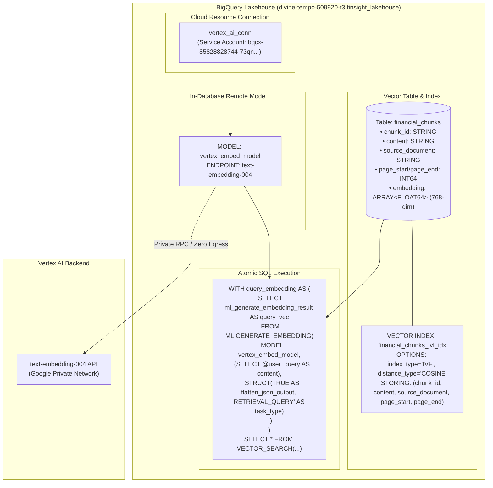

# Phase 3: BigQuery Vector Search, 768-Dim Embeddings & Remote Models

> **Milestone:** In-Database Vector Retrieval & Cloud Resource Connection Setup  
> **Target Alignment:** Senior Cloud Data Engineer & Machine Learning Engineer (BigQuery AI/ML, Vector Search, Vertex AI)  
> **Status:** Remote Model Registered & Verified  

---

## 1. Executive Summary & Objective

In enterprise data architectures, deploying dedicated vector databases (such as Pinecone Serverless, Milvus, or dedicated Vertex AI Vector Search index endpoints) introduces architectural fragmentation:
1. **Always-On Infrastructure Cost:** Dedicated Vertex AI Vector Search endpoints require standard node pools incurring **\$0.30+ per hour (\$216+/month)** even when zero queries are executing.
2. **Synchronization Lag & Dual Pipeline Debt:** Storing structured metadata in a data warehouse (BigQuery) while replicating unstructured text vectors to an external vector DB requires complex change data capture (CDC) pipelines and invites data drift.

**Phase 3** solves this by establishing **BigQuery Vector Search** with **In-Database Vertex AI Remote Models**. All regulatory filings, Markdown tables, 768-dimensional embeddings, and metadata remain unified within BigQuery, running cosine similarity search at **\$0.00 idle infrastructure cost** and scaling automatically under BigQuery's permanent monthly Free Tier (10 GiB storage, 1 TiB query scans).

---

## 2. In-Database Vector Search Architecture Blueprint



---

## 3. Engineering Comparison: BigQuery Vector Search vs. Dedicated Vector Stores

| Architecture Dimension | Pinecone Serverless | Vertex AI Dedicated Index Endpoint | **BigQuery Vector Search (Selected)** |
| :--- | :--- | :--- | :--- |
| **Idle Infrastructure Cost** | \$0 idle (but \$8–\$20/mo minimum per namespace index) | **~\$0.30+/hr (\$216+/month)** | **\$0.00 / month** |
| **Data Lakehouse Co-location** | ❌ Disjoint database requiring external sync | ❌ Separate API endpoint and metadata storage | **✅ Native in-warehouse storage & unified SQL** |
| **Pre/Post-Filtering Query Power** | Basic key-value tag filtering | Restricted filter expressions | **✅ Full ANSI SQL (Joins, Aggregations, Regex, Window Functions)** |
| **Egress Overhead** | Internet egress between cloud warehouse & vector host | VPC Peering / Private Service Access needed | **✅ Private Google Network Fabric (Zero egress cost)** |
| **Maintenance Burden** | Index lifecycle management & SDK version pinning | Index update pipelines & endpoint deployments | **✅ Managed serverless maintenance** |

---

## 4. Provisioning Cloud Resource Connection & IAM Roles

To allow BigQuery to invoke Vertex AI `text-embedding-004` securely without managing service account keys:

### 4.1 Create Connection
```bash
bq mk --connection \
  --location=US \
  --project_id=divine-tempo-509920-t3 \
  --connection_type=CLOUD_RESOURCE \
  vertex_ai_conn
```

### 4.2 Grant IAM Permissions to Connection Service Agent
```bash
# Service Agent: bqcx-85828828744-73qn@gcp-sa-bigquery-condel.iam.gserviceaccount.com
gcloud projects add-iam-policy-binding divine-tempo-509920-t3 \
  --member="serviceAccount:bqcx-85828828744-73qn@gcp-sa-bigquery-condel.iam.gserviceaccount.com" \
  --role="roles/aiplatform.user"
```

### 4.3 Register BigQuery Remote Model
```sql
CREATE OR REPLACE MODEL `divine-tempo-509920-t3.finsight_lakehouse.vertex_embed_model`
REMOTE WITH CONNECTION `divine-tempo-509920-t3.us.vertex_ai_conn`
OPTIONS (ENDPOINT = 'text-embedding-004');
```

---

## 5. End-to-End Pure SQL Vector Search Recipe

Once chunks are loaded into BigQuery, semantic vector search executes directly inside BigQuery SQL:

```sql
WITH query_embedding AS (
    SELECT ml_generate_embedding_result AS query_vec
    FROM ML.GENERATE_EMBEDDING(
        MODEL `divine-tempo-509920-t3.finsight_lakehouse.vertex_embed_model`,
        (SELECT 'What are Berkshire Hathaway’s primary risks regarding insurance underwriting?' AS content),
        STRUCT(TRUE AS flatten_json_output, 'RETRIEVAL_QUERY' AS task_type)
    )
)
SELECT
    base.chunk_id,
    base.source_document,
    base.page_start,
    base.page_end,
    LEFT(base.content, 300) AS content_preview,
    distance
FROM VECTOR_SEARCH(
    TABLE `divine-tempo-509920-t3.finsight_lakehouse.financial_chunks`,
    'embedding',
    TABLE query_embedding,
    query_column_to_search => 'query_vec',
    top_k => 5,
    distance_type => 'COSINE'
)
ORDER BY distance ASC;
```

---

## 6. Senior Data Engineer Interview Talking Points

### Q: How does BigQuery Vector Search handle indexing thresholds?
> **Answer:** BigQuery Vector Search features an intelligent dual-mode engine. For corpora containing 5,000 or more rows, it partitions vectors using Inverted File Flat (IVF) indexing to achieve low-latency approximate nearest neighbor (ANN) retrieval. For smaller corpora (<5,000 rows), BigQuery automatically falls back to brute-force exact vector search, ensuring 100% recall with negligible latency on lightweight datasets.

### Q: Why use `STORING(...)` in BigQuery Vector Index creation?
> **Answer:** The `STORING(...)` clause includes non-vector metadata columns (such as `chunk_id`, `content`, `source_document`, `page_start`, `page_end`) directly within the vector index storage layer. When `VECTOR_SEARCH` executes, BigQuery satisfies the entire query—both distance calculation and metadata retrieval—without executing a secondary random read against the base columnar table. This substantially reduces query latency and scanned byte costs.
